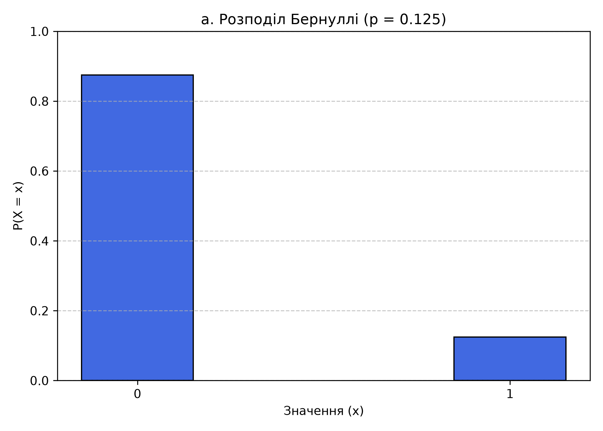
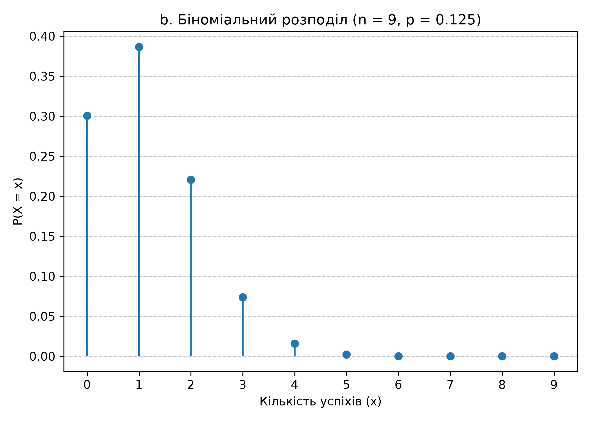
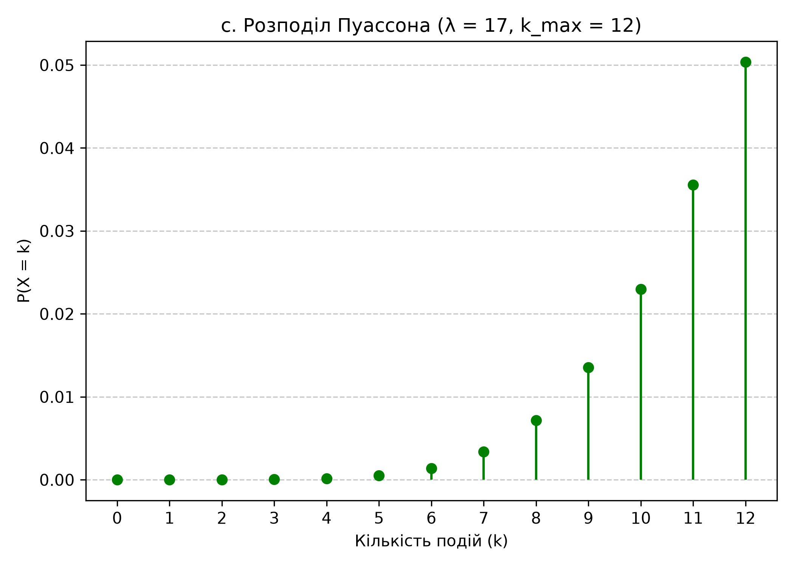
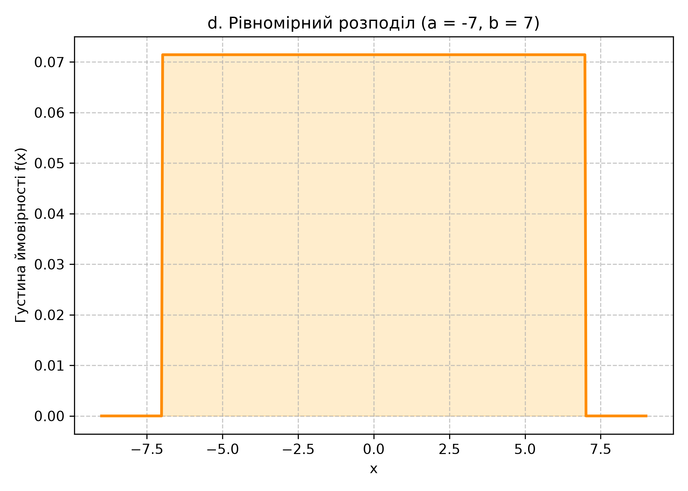
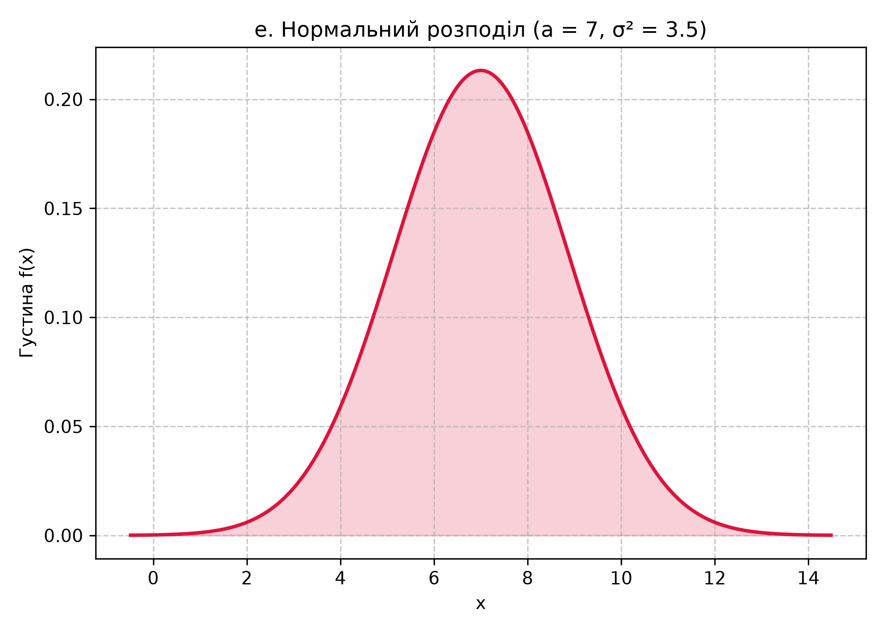
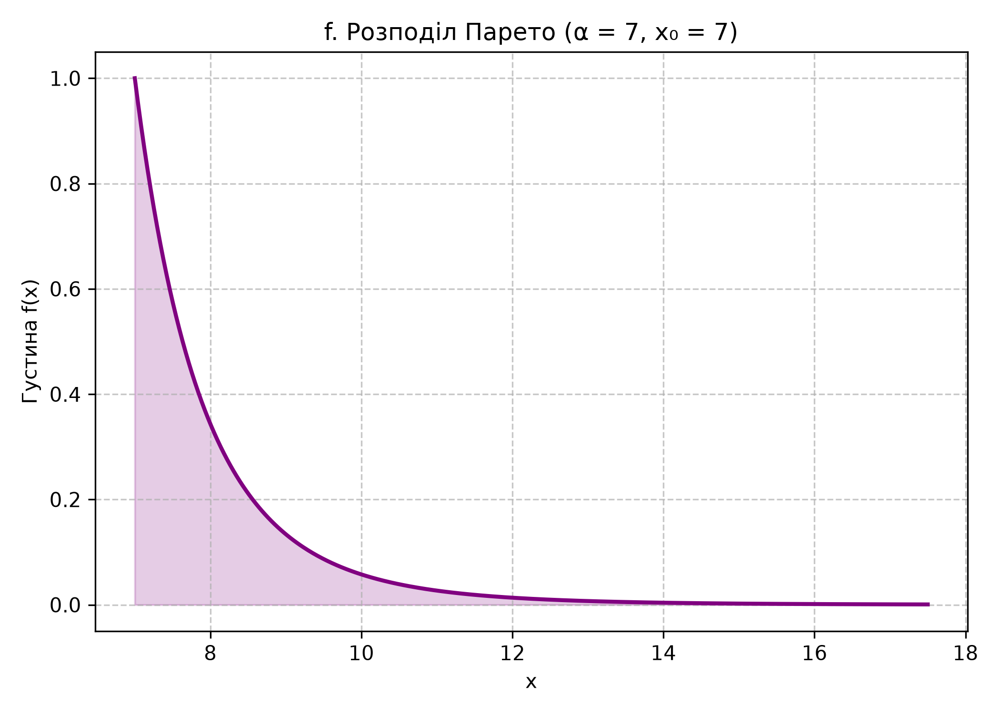
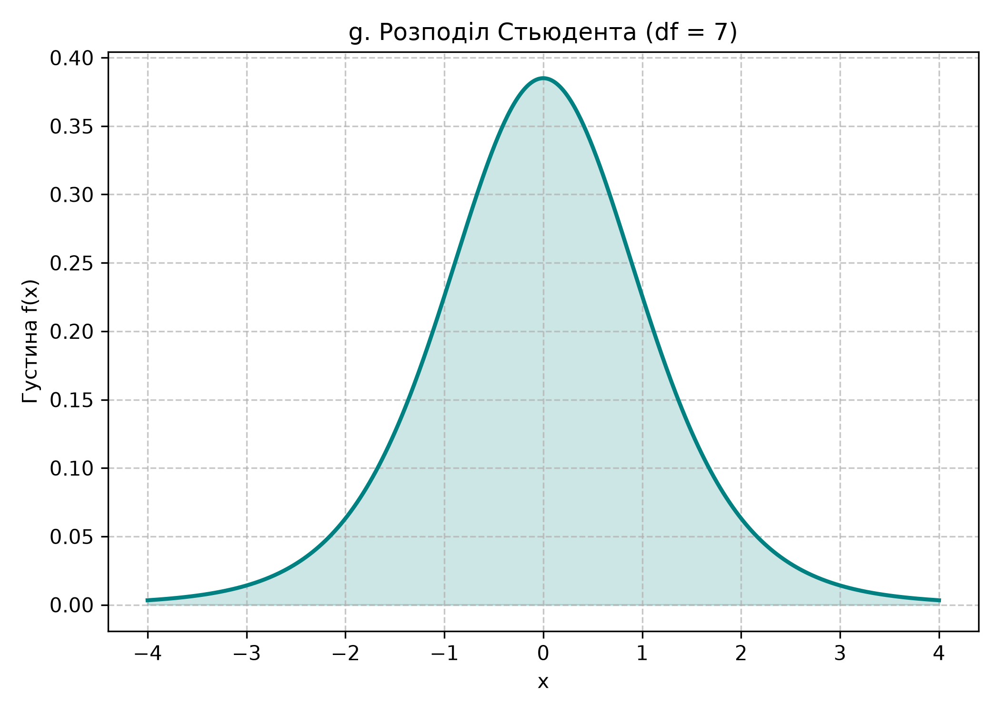

# Лабораторна робота №1

## Розподіли випадкових величин: неперервні та дискретні

**Варіант:** 7  
**Порядковий номер студента:** $N = 7$

Програма обчислює параметри заданих розподілів випадкових величин, будує відповідні графіки та зберігає їх у папку `plots`.

## Використані розподіли

| Позначення | Розподіл | Параметри для варіанта 7 |
|---|---|---|
| a | Бернуллі | $p = \frac{1}{N+1} = 0.125$ |
| b | Біноміальний | $n = N+2 = 9$, $p = 0.125$ |
| c | Пуассона | $\lambda = N+10 = 17$, $k_{max}=N+5=12$ |
| d | Рівномірний | $a=-N=-7$, $b=N=7$ |
| e | Нормальний | $\mu=N=7$, $\sigma^2=\frac{N}{2}=3.5$ |
| f | Парето | $\alpha=x_0=N=7$ |
| g | Стьюдента | кількість ступенів вільності $df=N=7$ |

## Результати

### Розподіл Бернуллі



### Біноміальний розподіл



### Розподіл Пуассона



### Рівномірний розподіл



### Нормальний розподіл



### Розподіл Парето



### Розподіл Стьюдента



## Запуск програми

Перейдіть до папки лабораторної та запустіть програму:

```powershell
cd lab01
py main.py
```
