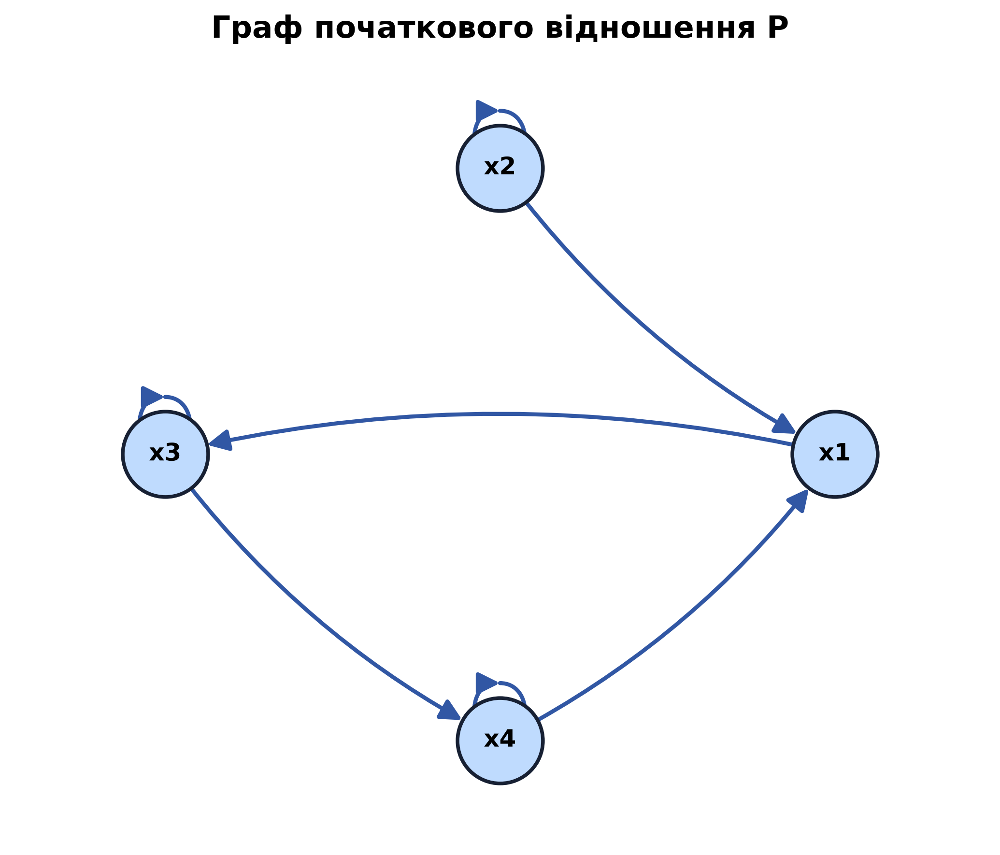
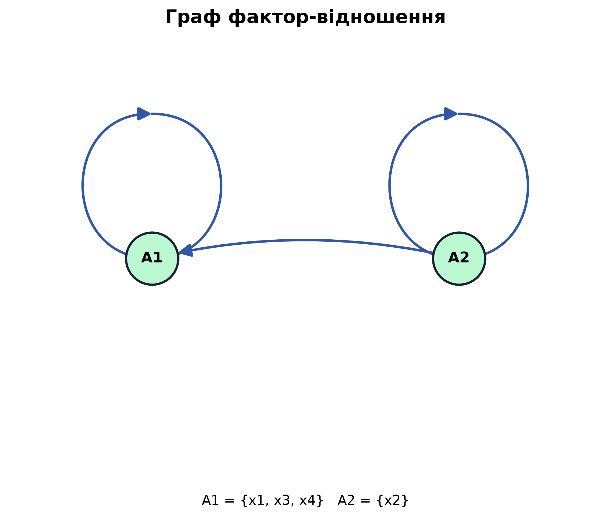

# Лабораторна робота №3

## Агрегування та факторизація бінарного відношення

## Початкова матриця відношення $P$

|   | x1 | x2 | x3 | x4 |
|:---:|:---:|:---:|:---:|:---:|
| **x1** | 0 | 0 | 1 | 0 |
| **x2** | 1 | 1 | 0 | 0 |
| **x3** | 0 | 0 | 1 | 1 |
| **x4** | 1 | 0 | 0 | 1 |

## Граф початкового відношення

## Матриця $P^1$

|   | x1 | x2 | x3 | x4 |
|:---:|:---:|:---:|:---:|:---:|
| **x1** | 0 | 0 | 1 | 0 |
| **x2** | 1 | 1 | 0 | 0 |
| **x3** | 0 | 0 | 1 | 1 |
| **x4** | 1 | 0 | 0 | 1 |

## Матриця $P^2$

|   | x1 | x2 | x3 | x4 |
|:---:|:---:|:---:|:---:|:---:|
| **x1** | 0 | 0 | 1 | 1 |
| **x2** | 1 | 1 | 1 | 0 |
| **x3** | 1 | 0 | 1 | 1 |
| **x4** | 1 | 0 | 1 | 1 |

## Матриця $P^3$

|   | x1 | x2 | x3 | x4 |
|:---:|:---:|:---:|:---:|:---:|
| **x1** | 1 | 0 | 1 | 1 |
| **x2** | 1 | 1 | 1 | 1 |
| **x3** | 1 | 0 | 1 | 1 |
| **x4** | 1 | 0 | 1 | 1 |

## Матриця $P^4$

|   | x1 | x2 | x3 | x4 |
|:---:|:---:|:---:|:---:|:---:|
| **x1** | 1 | 0 | 1 | 1 |
| **x2** | 1 | 1 | 1 | 1 |
| **x3** | 1 | 0 | 1 | 1 |
| **x4** | 1 | 0 | 1 | 1 |

## Транзитивне замикання

|   | x1 | x2 | x3 | x4 |
|:---:|:---:|:---:|:---:|:---:|
| **x1** | 1 | 0 | 1 | 1 |
| **x2** | 1 | 1 | 1 | 1 |
| **x3** | 1 | 0 | 1 | 1 |
| **x4** | 1 | 0 | 1 | 1 |

## Матриця досяжності

|   | x1 | x2 | x3 | x4 |
|:---:|:---:|:---:|:---:|:---:|
| **x1** | 1 | 0 | 1 | 1 |
| **x2** | 1 | 1 | 1 | 1 |
| **x3** | 1 | 0 | 1 | 1 |
| **x4** | 1 | 0 | 1 | 1 |

## Обернена матриця досяжності

|   | x1 | x2 | x3 | x4 |
|:---:|:---:|:---:|:---:|:---:|
| **x1** | 1 | 1 | 1 | 1 |
| **x2** | 0 | 1 | 0 | 0 |
| **x3** | 1 | 1 | 1 | 1 |
| **x4** | 1 | 1 | 1 | 1 |

## Матриця взаємної досяжності

|   | x1 | x2 | x3 | x4 |
|:---:|:---:|:---:|:---:|:---:|
| **x1** | 1 | 0 | 1 | 1 |
| **x2** | 0 | 1 | 0 | 0 |
| **x3** | 1 | 0 | 1 | 1 |
| **x4** | 1 | 0 | 1 | 1 |

## Класи взаємної досяжності

- $A_1 = \{x1, x3, x4\}$
- $A_2 = \{x2\}$

## Матриця фактор-відношення

|   | A1 | A2 |
|:---:|:---:|:---:|
| **A1** | 1 | 0 |
| **A2** | 1 | 1 |

## Граф фактор-відношення

