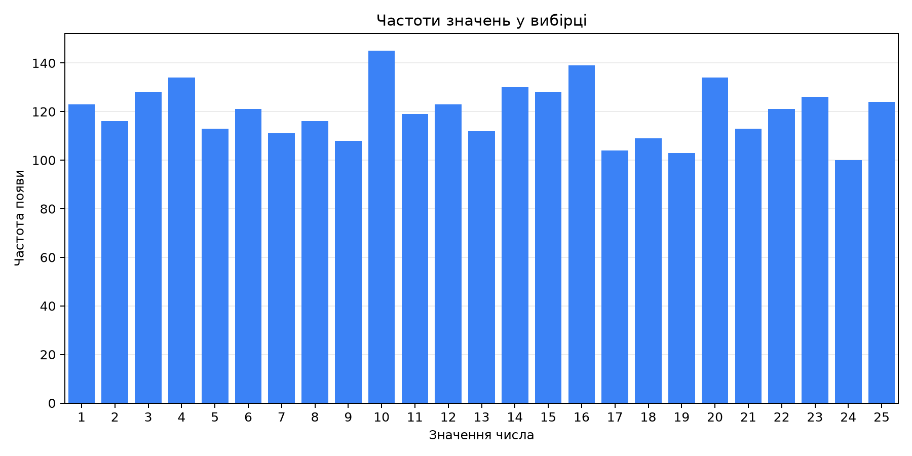

# Лабораторна робота №4

## Методи обчислення середніх величин

**Номер у журналі:** 5  
**Обсяг вибірки:** 3000 чисел  
**Діапазон генерації:** від 1 до 25 включно  
**Зерно генератора:** 5 (для повторення результату)

## Частоти значень



| Значення числа | Частота появи |
|---:|---:|
| 1 | 123 |
| 2 | 116 |
| 3 | 128 |
| 4 | 134 |
| 5 | 113 |
| 6 | 121 |
| 7 | 111 |
| 8 | 116 |
| 9 | 108 |
| 10 | 145 |
| 11 | 119 |
| 12 | 123 |
| 13 | 112 |
| 14 | 130 |
| 15 | 128 |
| 16 | 139 |
| 17 | 104 |
| 18 | 109 |
| 19 | 103 |
| 20 | 134 |
| 21 | 113 |
| 22 | 121 |
| 23 | 126 |
| 24 | 100 |
| 25 | 124 |

## Середні величини

| Показник | Значення |
|---|---:|
| Середнє арифметичне | 12.899333 |
| Мода | 10 |
| Медіана | 13.000000 |
| Середнє квадратичне | 14.769157 |
| Середнє геометричне | 10.080092 |
| Середнє гармонічне | 6.482832 |

Медіана для парної вибірки — середнє двох центральних чисел відсортованого ряду. Якщо в рядку моди кілька чисел, вони мають однакову найбільшу частоту.

## Згенерована вибірка

<details>
<summary>Показати всі 3000 чисел у порядку генерації</summary>

```text
20 9 24 12 23 24 21 17 1 15 25 8 21 2 6 4 12 16 8 13 18 4 19 8 1 24 7 14 9 6
25 13 6 25 3 5 20 20 15 5 5 1 1 7 25 7 6 6 10 11 7 18 22 21 7 6 23 7 13 10
1 12 14 6 5 9 3 11 10 20 19 1 20 22 23 11 3 10 12 10 16 23 11 6 16 16 23 6 2 9
1 24 12 13 1 18 14 12 13 19 1 15 2 23 6 20 7 4 25 8 15 12 17 12 17 9 25 15 4 19
24 25 12 10 2 14 3 7 11 17 20 12 5 11 9 23 18 3 10 22 11 10 6 3 21 5 24 23 10 16
6 24 2 3 20 18 13 2 8 24 20 12 9 15 21 14 5 2 21 2 16 11 7 5 24 19 5 21 14 4
6 14 12 5 2 14 10 5 15 20 6 17 15 16 23 24 11 16 9 10 16 13 5 4 13 18 6 21 16 11
6 3 16 9 17 18 17 12 3 25 12 23 19 22 2 25 10 12 18 23 22 9 16 9 25 23 23 10 11 21
6 19 1 16 18 25 9 11 22 9 15 10 17 21 22 12 12 9 21 12 24 14 12 6 23 15 12 11 17 5
17 6 7 12 16 10 23 3 24 22 24 14 6 20 25 19 17 22 14 10 20 18 25 21 9 24 1 7 6 19
15 20 21 6 8 25 22 6 21 23 2 16 8 6 2 5 4 11 6 16 7 18 2 14 15 12 13 22 20 3
19 7 8 23 12 1 12 13 9 14 4 23 18 12 2 18 20 10 4 10 18 17 11 19 10 12 5 14 14 19
21 18 12 15 5 6 20 13 19 16 7 5 20 3 12 22 1 13 4 11 19 20 18 5 11 21 19 13 14 14
8 16 10 16 23 13 13 6 20 20 9 24 10 16 9 14 1 11 10 16 10 5 16 1 4 22 20 15 8 10
2 5 13 1 16 18 18 9 8 16 2 8 16 9 5 24 10 10 16 20 16 17 21 20 24 4 1 25 5 10
10 18 23 11 20 10 24 17 1 15 12 12 22 24 19 5 2 1 9 18 15 22 4 22 18 7 1 14 25 14
20 19 23 23 21 21 16 13 16 13 22 24 7 10 15 25 3 10 1 23 25 14 19 10 21 25 16 10 5 6
16 23 18 16 11 18 5 14 19 18 2 3 24 8 9 3 3 22 1 11 24 14 3 13 23 16 2 4 4 8
20 21 4 23 5 10 23 15 5 6 20 6 14 6 3 20 7 2 18 4 22 13 24 3 9 2 19 19 4 24
13 20 5 1 14 3 11 22 20 16 16 12 21 12 2 5 23 10 5 19 21 22 17 10 18 18 20 8 9 3
18 8 9 25 10 17 5 8 12 15 24 13 6 5 23 1 21 11 3 19 22 2 3 4 17 20 15 8 13 15
16 11 4 17 1 18 24 13 2 5 14 22 8 24 4 3 22 16 7 5 23 20 13 12 8 10 11 20 23 12
13 13 5 24 12 21 10 21 14 12 17 2 19 19 7 24 6 13 3 4 2 2 6 7 7 2 16 16 22 25
12 1 14 16 10 20 14 11 15 15 4 7 5 21 6 3 12 13 16 5 18 9 4 9 6 25 10 22 8 2
16 2 12 25 12 11 2 23 1 22 15 16 5 4 22 11 10 15 22 8 24 6 2 7 23 1 19 8 22 3
20 13 23 12 22 10 6 15 12 10 3 24 23 15 6 25 8 6 22 7 2 21 20 14 24 9 1 15 2 15
25 22 14 6 2 2 18 17 19 12 4 23 3 8 16 3 16 2 22 8 21 2 16 13 2 2 9 14 15 10
21 2 2 7 6 23 17 21 13 7 18 8 3 11 4 3 18 6 20 3 24 7 20 1 15 18 12 16 14 19
25 13 17 21 5 24 1 25 10 23 15 8 18 4 5 10 16 3 25 25 9 13 11 5 5 18 3 16 8 23
3 14 19 22 8 9 2 16 23 8 2 23 7 10 12 4 3 14 25 11 13 25 25 18 1 10 21 25 5 19
1 15 5 23 21 1 24 2 23 14 9 4 13 18 5 11 3 10 6 5 9 16 22 11 10 2 3 18 25 24
18 1 1 4 2 5 12 14 9 20 1 8 17 14 5 12 7 11 12 1 6 19 20 6 24 4 9 17 20 6
21 23 5 15 25 14 14 4 11 11 15 8 15 20 14 6 15 2 25 22 6 18 16 16 20 1 4 5 14 22
2 7 1 2 19 8 16 23 12 13 15 7 7 9 7 10 18 17 12 25 25 8 12 12 8 22 2 20 16 13
12 5 5 8 16 13 2 4 6 13 4 25 23 10 7 25 11 16 22 16 18 20 3 7 13 23 1 4 17 20
19 20 6 13 1 11 22 1 20 10 17 13 17 16 18 23 23 13 15 19 23 18 22 2 18 5 14 12 19 1
22 25 17 7 10 10 3 1 3 25 12 20 19 25 23 14 10 1 9 23 8 3 2 25 3 22 10 12 23 24
20 20 18 7 16 17 3 4 8 11 18 14 13 1 22 13 13 6 25 21 17 7 22 20 11 13 11 4 23 18
23 23 12 8 4 7 10 10 9 20 3 6 3 21 14 25 6 8 21 3 19 19 21 21 18 24 14 14 8 14
16 17 20 8 10 14 9 3 20 11 6 14 1 5 4 10 19 18 20 19 6 14 7 11 20 4 21 23 11 24
3 2 16 5 17 3 11 7 15 21 13 8 23 20 16 4 1 7 22 6 4 3 11 5 12 20 25 4 19 25
15 24 11 25 6 23 18 19 21 4 12 4 3 7 7 11 12 6 15 22 24 25 3 8 13 18 15 13 1 4
20 12 5 22 1 16 13 11 24 3 16 25 24 23 10 1 4 16 12 25 24 7 11 13 5 10 16 21 23 25
3 19 4 10 14 11 3 17 14 2 8 14 8 9 22 24 3 5 9 4 18 16 14 6 18 13 8 3 15 12
5 3 1 25 5 12 1 1 9 18 15 13 17 3 2 7 7 15 1 16 17 3 9 20 22 16 17 1 2 6
13 25 25 17 14 19 22 21 20 21 19 2 7 1 14 25 24 14 14 13 1 25 6 11 5 10 25 7 14 3
12 7 13 14 7 9 5 16 12 10 1 22 21 4 25 6 25 15 3 3 22 13 2 14 5 7 21 1 24 16
11 20 15 5 15 8 3 12 20 1 1 6 14 3 9 5 25 21 12 11 25 7 5 10 17 23 18 3 10 4
4 21 13 12 10 12 16 18 19 15 8 19 5 9 1 18 1 24 13 5 8 16 22 23 2 1 1 25 7 14
8 17 23 20 8 10 2 17 8 2 23 13 12 25 1 18 10 15 15 4 21 4 12 19 17 9 23 19 20 13
13 10 6 19 22 3 21 15 2 24 7 17 20 13 4 17 10 18 12 14 5 15 12 3 16 1 19 19 7 19
15 2 2 24 3 4 11 5 12 11 9 9 16 5 24 4 9 9 1 21 9 13 6 21 8 23 9 19 15 6
20 5 19 2 24 12 18 4 1 15 2 23 20 16 22 21 2 1 19 14 4 14 24 17 20 15 20 19 8 18
23 4 23 3 24 22 19 3 2 3 23 15 10 21 17 18 24 3 21 22 9 4 13 25 10 9 15 10 10 1
25 11 17 22 16 15 13 5 21 7 9 11 20 7 15 3 5 12 3 21 14 15 20 17 21 13 6 7 5 16
6 22 17 15 19 12 1 5 14 9 19 16 17 18 7 18 8 22 6 14 18 9 11 10 20 4 7 9 14 12
17 9 16 21 23 21 3 4 23 25 4 11 4 4 21 10 25 19 6 2 25 18 13 6 21 11 24 25 9 4
14 11 4 10 3 10 23 11 14 14 3 3 10 3 6 2 4 24 17 14 4 15 14 3 8 14 1 19 18 10
21 4 22 17 11 12 3 15 13 4 6 25 8 4 20 18 4 3 21 22 18 13 14 4 9 10 18 15 14 2
7 17 5 13 22 21 6 7 11 23 17 3 5 10 2 21 15 10 15 18 19 21 17 9 10 6 24 21 9 15
16 13 25 23 20 4 5 20 7 15 23 24 25 4 15 8 5 8 6 21 3 24 15 9 20 15 22 6 23 16
4 10 19 9 21 12 23 2 18 24 18 4 7 25 1 11 19 19 16 21 16 17 20 10 20 11 2 10 5 17
14 10 14 12 25 5 10 21 7 25 24 2 1 16 6 10 14 22 10 14 19 22 15 11 24 17 17 11 23 23
20 1 6 19 16 21 1 18 16 25 15 12 2 8 18 1 16 4 24 7 6 6 17 8 22 13 21 4 13 14
21 8 21 9 1 7 22 8 19 3 24 17 12 14 19 10 8 24 4 12 18 20 18 25 15 22 24 2 9 17
1 5 14 2 15 1 7 25 7 4 6 15 15 16 16 10 17 3 1 25 23 25 20 20 15 20 20 20 23 20
7 1 21 15 17 7 3 23 11 7 4 18 12 3 6 8 13 1 2 14 2 10 7 24 13 13 6 25 4 13
23 7 7 5 13 15 5 14 1 9 15 17 25 7 23 23 22 9 25 3 8 14 14 22 22 18 23 24 15 24
7 7 11 19 9 23 22 25 2 7 18 6 12 21 4 23 20 14 12 5 21 10 6 1 18 5 23 14 4 24
1 23 18 15 11 24 3 16 5 12 1 2 24 20 12 25 16 9 19 15 11 20 18 14 6 13 14 18 15 1
8 16 10 4 17 3 25 18 16 8 3 22 21 20 11 4 3 24 11 14 6 11 12 25 25 2 10 21 22 25
4 17 3 25 21 22 21 3 2 16 17 16 7 15 10 5 14 9 20 15 19 3 22 17 8 10 3 19 10 3
13 10 14 4 6 12 21 14 3 11 7 12 22 4 15 11 4 16 11 2 22 15 23 2 20 8 10 10 9 15
17 17 12 17 17 3 17 19 15 14 22 7 20 24 13 14 4 5 3 15 11 2 10 12 14 20 19 4 6 1
15 5 24 10 2 19 4 19 25 23 2 3 3 10 21 10 10 14 22 8 2 14 15 10 6 23 11 17 23 17
19 13 15 20 15 2 6 12 16 11 20 3 4 15 9 12 11 21 4 13 13 15 9 5 5 24 24 18 15 12
9 6 6 14 1 22 13 11 9 7 20 5 14 20 17 15 4 10 13 2 7 7 22 13 8 23 16 19 22 17
1 4 25 18 10 4 11 11 20 12 6 1 2 7 16 2 9 16 17 7 2 8 11 11 8 12 15 1 2 23
4 25 7 4 23 10 4 8 3 21 4 25 24 19 12 11 9 14 6 25 9 10 3 13 6 8 24 16 1 25
10 16 8 2 24 24 24 25 18 7 13 22 19 4 10 16 2 23 9 1 15 5 4 24 3 8 11 12 8 20
16 1 23 24 1 19 11 17 13 12 11 9 21 7 19 10 15 5 22 1 19 19 7 8 1 19 10 3 8 8
7 13 22 21 19 7 10 24 5 7 25 6 4 20 19 20 23 24 20 16 8 15 21 10 23 9 3 20 6 19
15 18 21 4 22 24 21 12 19 16 17 1 10 1 18 6 20 6 21 10 13 9 16 20 20 21 11 5 7 15
18 18 21 7 24 4 20 1 16 6 10 18 1 7 9 23 6 9 13 9 3 21 12 10 23 4 20 8 1 20
8 9 13 15 9 3 16 13 16 5 13 22 24 16 18 2 25 13 20 20 2 7 17 25 22 9 11 17 22 6
12 14 20 20 22 22 6 13 23 23 23 8 19 20 20 22 2 10 25 8 14 16 16 17 24 6 25 15 16 16
15 21 19 8 8 11 23 23 8 5 3 4 25 15 21 15 18 21 1 22 5 1 16 23 20 22 23 5 4 2
25 3 14 15 6 4 25 1 11 25 14 18 22 17 21 25 11 23 8 6 16 17 16 22 18 11 2 25 19 11
1 16 2 7 7 18 9 9 10 8 22 8 15 22 3 19 16 16 8 11 14 9 7 12 14 1 11 4 5 8
11 10 25 8 12 25 8 10 4 21 18 16 9 4 18 17 21 9 2 5 22 4 4 15 10 25 5 18 8 11
11 6 2 14 21 14 13 1 4 9 17 23 13 24 3 4 1 11 10 18 15 5 24 21 5 12 18 10 9 3
14 14 17 1 15 16 10 24 16 4 10 17 25 3 8 14 4 4 19 8 21 17 20 13 17 7 22 22 22 16
17 17 12 7 5 23 1 1 4 20 13 14 1 22 15 11 18 8 11 16 9 7 8 16 16 9 3 9 3 20
19 18 10 23 14 2 22 15 2 22 6 2 8 14 17 19 5 7 12 8 22 3 25 17 14 6 8 15 21 16
19 5 15 6 12 16 4 15 10 3 15 11 22 12 20 24 8 3 17 9 22 21 12 10 22 17 2 24 12 12
12 6 8 13 17 14 12 20 9 14 14 8 20 6 25 23 1 11 2 4 25 7 24 14 25 17 20 16 22 24
4 14 7 12 8 13 4 19 2 13 11 8 12 6 14 11 9 10 16 11 6 8 2 25 15 11 8 3 21 16
12 10 3 10 5 20 11 17 23 16 25 22 6 16 7 13 15 9 21 20 19 1 23 20 7 4 14 25 6 17
1 23 22 19 11 23 9 25 1 1 22 18 12 14 22 22 4 23 17 8 22 25 6 23 19 21 11 10 23 7
20 13 23 6 5 20 16 10 20 13 24 15 11 23 9 11 11 2 10 22 13 16 20 18 25 21 8 9 3 4
```

</details>

## Проранжована вибірка

<details>
<summary>Показати всі 3000 чисел за зростанням</summary>

```text
1 1 1 1 1 1 1 1 1 1 1 1 1 1 1 1 1 1 1 1 1 1 1 1 1 1 1 1 1 1
1 1 1 1 1 1 1 1 1 1 1 1 1 1 1 1 1 1 1 1 1 1 1 1 1 1 1 1 1 1
1 1 1 1 1 1 1 1 1 1 1 1 1 1 1 1 1 1 1 1 1 1 1 1 1 1 1 1 1 1
1 1 1 1 1 1 1 1 1 1 1 1 1 1 1 1 1 1 1 1 1 1 1 1 1 1 1 1 1 1
1 1 1 2 2 2 2 2 2 2 2 2 2 2 2 2 2 2 2 2 2 2 2 2 2 2 2 2 2 2
2 2 2 2 2 2 2 2 2 2 2 2 2 2 2 2 2 2 2 2 2 2 2 2 2 2 2 2 2 2
2 2 2 2 2 2 2 2 2 2 2 2 2 2 2 2 2 2 2 2 2 2 2 2 2 2 2 2 2 2
2 2 2 2 2 2 2 2 2 2 2 2 2 2 2 2 2 2 2 2 2 2 2 2 2 2 2 2 2 3
3 3 3 3 3 3 3 3 3 3 3 3 3 3 3 3 3 3 3 3 3 3 3 3 3 3 3 3 3 3
3 3 3 3 3 3 3 3 3 3 3 3 3 3 3 3 3 3 3 3 3 3 3 3 3 3 3 3 3 3
3 3 3 3 3 3 3 3 3 3 3 3 3 3 3 3 3 3 3 3 3 3 3 3 3 3 3 3 3 3
3 3 3 3 3 3 3 3 3 3 3 3 3 3 3 3 3 3 3 3 3 3 3 3 3 3 3 3 3 3
3 3 3 3 3 3 3 4 4 4 4 4 4 4 4 4 4 4 4 4 4 4 4 4 4 4 4 4 4 4
4 4 4 4 4 4 4 4 4 4 4 4 4 4 4 4 4 4 4 4 4 4 4 4 4 4 4 4 4 4
4 4 4 4 4 4 4 4 4 4 4 4 4 4 4 4 4 4 4 4 4 4 4 4 4 4 4 4 4 4
4 4 4 4 4 4 4 4 4 4 4 4 4 4 4 4 4 4 4 4 4 4 4 4 4 4 4 4 4 4
4 4 4 4 4 4 4 4 4 4 4 4 4 4 4 4 4 4 4 4 4 5 5 5 5 5 5 5 5 5
5 5 5 5 5 5 5 5 5 5 5 5 5 5 5 5 5 5 5 5 5 5 5 5 5 5 5 5 5 5
5 5 5 5 5 5 5 5 5 5 5 5 5 5 5 5 5 5 5 5 5 5 5 5 5 5 5 5 5 5
5 5 5 5 5 5 5 5 5 5 5 5 5 5 5 5 5 5 5 5 5 5 5 5 5 5 5 5 5 5
5 5 5 5 5 5 5 5 5 5 5 5 5 5 6 6 6 6 6 6 6 6 6 6 6 6 6 6 6 6
6 6 6 6 6 6 6 6 6 6 6 6 6 6 6 6 6 6 6 6 6 6 6 6 6 6 6 6 6 6
6 6 6 6 6 6 6 6 6 6 6 6 6 6 6 6 6 6 6 6 6 6 6 6 6 6 6 6 6 6
6 6 6 6 6 6 6 6 6 6 6 6 6 6 6 6 6 6 6 6 6 6 6 6 6 6 6 6 6 6
6 6 6 6 6 6 6 6 6 6 6 6 6 6 6 7 7 7 7 7 7 7 7 7 7 7 7 7 7 7
7 7 7 7 7 7 7 7 7 7 7 7 7 7 7 7 7 7 7 7 7 7 7 7 7 7 7 7 7 7
7 7 7 7 7 7 7 7 7 7 7 7 7 7 7 7 7 7 7 7 7 7 7 7 7 7 7 7 7 7
7 7 7 7 7 7 7 7 7 7 7 7 7 7 7 7 7 7 7 7 7 7 7 7 7 7 7 7 7 7
7 7 7 7 7 7 8 8 8 8 8 8 8 8 8 8 8 8 8 8 8 8 8 8 8 8 8 8 8 8
8 8 8 8 8 8 8 8 8 8 8 8 8 8 8 8 8 8 8 8 8 8 8 8 8 8 8 8 8 8
8 8 8 8 8 8 8 8 8 8 8 8 8 8 8 8 8 8 8 8 8 8 8 8 8 8 8 8 8 8
8 8 8 8 8 8 8 8 8 8 8 8 8 8 8 8 8 8 8 8 8 8 8 8 8 8 8 8 8 8
8 8 9 9 9 9 9 9 9 9 9 9 9 9 9 9 9 9 9 9 9 9 9 9 9 9 9 9 9 9
9 9 9 9 9 9 9 9 9 9 9 9 9 9 9 9 9 9 9 9 9 9 9 9 9 9 9 9 9 9
9 9 9 9 9 9 9 9 9 9 9 9 9 9 9 9 9 9 9 9 9 9 9 9 9 9 9 9 9 9
9 9 9 9 9 9 9 9 9 9 9 9 9 9 9 9 9 9 9 9 10 10 10 10 10 10 10 10 10 10
10 10 10 10 10 10 10 10 10 10 10 10 10 10 10 10 10 10 10 10 10 10 10 10 10 10 10 10 10 10
10 10 10 10 10 10 10 10 10 10 10 10 10 10 10 10 10 10 10 10 10 10 10 10 10 10 10 10 10 10
10 10 10 10 10 10 10 10 10 10 10 10 10 10 10 10 10 10 10 10 10 10 10 10 10 10 10 10 10 10
10 10 10 10 10 10 10 10 10 10 10 10 10 10 10 10 10 10 10 10 10 10 10 10 10 10 10 10 10 10
10 10 10 10 10 10 10 10 10 10 10 10 10 10 10 11 11 11 11 11 11 11 11 11 11 11 11 11 11 11
11 11 11 11 11 11 11 11 11 11 11 11 11 11 11 11 11 11 11 11 11 11 11 11 11 11 11 11 11 11
11 11 11 11 11 11 11 11 11 11 11 11 11 11 11 11 11 11 11 11 11 11 11 11 11 11 11 11 11 11
11 11 11 11 11 11 11 11 11 11 11 11 11 11 11 11 11 11 11 11 11 11 11 11 11 11 11 11 11 11
11 11 11 11 11 11 11 11 11 11 11 11 11 11 12 12 12 12 12 12 12 12 12 12 12 12 12 12 12 12
12 12 12 12 12 12 12 12 12 12 12 12 12 12 12 12 12 12 12 12 12 12 12 12 12 12 12 12 12 12
12 12 12 12 12 12 12 12 12 12 12 12 12 12 12 12 12 12 12 12 12 12 12 12 12 12 12 12 12 12
12 12 12 12 12 12 12 12 12 12 12 12 12 12 12 12 12 12 12 12 12 12 12 12 12 12 12 12 12 12
12 12 12 12 12 12 12 12 12 12 12 12 12 12 12 12 12 13 13 13 13 13 13 13 13 13 13 13 13 13
13 13 13 13 13 13 13 13 13 13 13 13 13 13 13 13 13 13 13 13 13 13 13 13 13 13 13 13 13 13
13 13 13 13 13 13 13 13 13 13 13 13 13 13 13 13 13 13 13 13 13 13 13 13 13 13 13 13 13 13
13 13 13 13 13 13 13 13 13 13 13 13 13 13 13 13 13 13 13 13 13 13 13 13 13 13 13 13 13 13
13 13 13 13 13 13 13 13 13 14 14 14 14 14 14 14 14 14 14 14 14 14 14 14 14 14 14 14 14 14
14 14 14 14 14 14 14 14 14 14 14 14 14 14 14 14 14 14 14 14 14 14 14 14 14 14 14 14 14 14
14 14 14 14 14 14 14 14 14 14 14 14 14 14 14 14 14 14 14 14 14 14 14 14 14 14 14 14 14 14
14 14 14 14 14 14 14 14 14 14 14 14 14 14 14 14 14 14 14 14 14 14 14 14 14 14 14 14 14 14
14 14 14 14 14 14 14 14 14 14 14 14 14 14 14 14 14 14 14 15 15 15 15 15 15 15 15 15 15 15
15 15 15 15 15 15 15 15 15 15 15 15 15 15 15 15 15 15 15 15 15 15 15 15 15 15 15 15 15 15
15 15 15 15 15 15 15 15 15 15 15 15 15 15 15 15 15 15 15 15 15 15 15 15 15 15 15 15 15 15
15 15 15 15 15 15 15 15 15 15 15 15 15 15 15 15 15 15 15 15 15 15 15 15 15 15 15 15 15 15
15 15 15 15 15 15 15 15 15 15 15 15 15 15 15 15 15 15 15 15 15 15 15 15 15 15 15 16 16 16
16 16 16 16 16 16 16 16 16 16 16 16 16 16 16 16 16 16 16 16 16 16 16 16 16 16 16 16 16 16
16 16 16 16 16 16 16 16 16 16 16 16 16 16 16 16 16 16 16 16 16 16 16 16 16 16 16 16 16 16
16 16 16 16 16 16 16 16 16 16 16 16 16 16 16 16 16 16 16 16 16 16 16 16 16 16 16 16 16 16
16 16 16 16 16 16 16 16 16 16 16 16 16 16 16 16 16 16 16 16 16 16 16 16 16 16 16 16 16 16
16 16 16 16 16 16 16 16 16 16 16 16 16 16 16 16 17 17 17 17 17 17 17 17 17 17 17 17 17 17
17 17 17 17 17 17 17 17 17 17 17 17 17 17 17 17 17 17 17 17 17 17 17 17 17 17 17 17 17 17
17 17 17 17 17 17 17 17 17 17 17 17 17 17 17 17 17 17 17 17 17 17 17 17 17 17 17 17 17 17
17 17 17 17 17 17 17 17 17 17 17 17 17 17 17 17 17 17 17 17 17 17 17 17 17 17 17 17 17 17
18 18 18 18 18 18 18 18 18 18 18 18 18 18 18 18 18 18 18 18 18 18 18 18 18 18 18 18 18 18
18 18 18 18 18 18 18 18 18 18 18 18 18 18 18 18 18 18 18 18 18 18 18 18 18 18 18 18 18 18
18 18 18 18 18 18 18 18 18 18 18 18 18 18 18 18 18 18 18 18 18 18 18 18 18 18 18 18 18 18
18 18 18 18 18 18 18 18 18 18 18 18 18 18 18 18 18 18 18 19 19 19 19 19 19 19 19 19 19 19
19 19 19 19 19 19 19 19 19 19 19 19 19 19 19 19 19 19 19 19 19 19 19 19 19 19 19 19 19 19
19 19 19 19 19 19 19 19 19 19 19 19 19 19 19 19 19 19 19 19 19 19 19 19 19 19 19 19 19 19
19 19 19 19 19 19 19 19 19 19 19 19 19 19 19 19 19 19 19 19 19 19 19 19 19 19 19 19 19 19
19 19 20 20 20 20 20 20 20 20 20 20 20 20 20 20 20 20 20 20 20 20 20 20 20 20 20 20 20 20
20 20 20 20 20 20 20 20 20 20 20 20 20 20 20 20 20 20 20 20 20 20 20 20 20 20 20 20 20 20
20 20 20 20 20 20 20 20 20 20 20 20 20 20 20 20 20 20 20 20 20 20 20 20 20 20 20 20 20 20
20 20 20 20 20 20 20 20 20 20 20 20 20 20 20 20 20 20 20 20 20 20 20 20 20 20 20 20 20 20
20 20 20 20 20 20 20 20 20 20 20 20 20 20 20 20 21 21 21 21 21 21 21 21 21 21 21 21 21 21
21 21 21 21 21 21 21 21 21 21 21 21 21 21 21 21 21 21 21 21 21 21 21 21 21 21 21 21 21 21
21 21 21 21 21 21 21 21 21 21 21 21 21 21 21 21 21 21 21 21 21 21 21 21 21 21 21 21 21 21
21 21 21 21 21 21 21 21 21 21 21 21 21 21 21 21 21 21 21 21 21 21 21 21 21 21 21 21 21 21
21 21 21 21 21 21 21 21 21 22 22 22 22 22 22 22 22 22 22 22 22 22 22 22 22 22 22 22 22 22
22 22 22 22 22 22 22 22 22 22 22 22 22 22 22 22 22 22 22 22 22 22 22 22 22 22 22 22 22 22
22 22 22 22 22 22 22 22 22 22 22 22 22 22 22 22 22 22 22 22 22 22 22 22 22 22 22 22 22 22
22 22 22 22 22 22 22 22 22 22 22 22 22 22 22 22 22 22 22 22 22 22 22 22 22 22 22 22 22 22
22 22 22 22 22 22 22 22 22 22 23 23 23 23 23 23 23 23 23 23 23 23 23 23 23 23 23 23 23 23
23 23 23 23 23 23 23 23 23 23 23 23 23 23 23 23 23 23 23 23 23 23 23 23 23 23 23 23 23 23
23 23 23 23 23 23 23 23 23 23 23 23 23 23 23 23 23 23 23 23 23 23 23 23 23 23 23 23 23 23
23 23 23 23 23 23 23 23 23 23 23 23 23 23 23 23 23 23 23 23 23 23 23 23 23 23 23 23 23 23
23 23 23 23 23 23 23 23 23 23 23 23 23 23 23 23 24 24 24 24 24 24 24 24 24 24 24 24 24 24
24 24 24 24 24 24 24 24 24 24 24 24 24 24 24 24 24 24 24 24 24 24 24 24 24 24 24 24 24 24
24 24 24 24 24 24 24 24 24 24 24 24 24 24 24 24 24 24 24 24 24 24 24 24 24 24 24 24 24 24
24 24 24 24 24 24 24 24 24 24 24 24 24 24 24 24 24 24 24 24 24 24 24 24 24 24 25 25 25 25
25 25 25 25 25 25 25 25 25 25 25 25 25 25 25 25 25 25 25 25 25 25 25 25 25 25 25 25 25 25
25 25 25 25 25 25 25 25 25 25 25 25 25 25 25 25 25 25 25 25 25 25 25 25 25 25 25 25 25 25
25 25 25 25 25 25 25 25 25 25 25 25 25 25 25 25 25 25 25 25 25 25 25 25 25 25 25 25 25 25
25 25 25 25 25 25 25 25 25 25 25 25 25 25 25 25 25 25 25 25 25 25 25 25 25 25 25 25 25 25
```

</details>

## Висновки

Для вибірки з 3000 цілих чисел від 1 до 25 обчислено шість показників центру. Середнє арифметичне (12.899) і медіана (13.000) описують центр вибірки різними способами; мода (10) показує найчастіше значення. Для додатних чисел справджується співвідношення: гармонічне ≤ геометричне ≤ арифметичне ≤ квадратичне. Отримано 6.483 ≤ 10.080 ≤ 12.899 ≤ 14.769.
