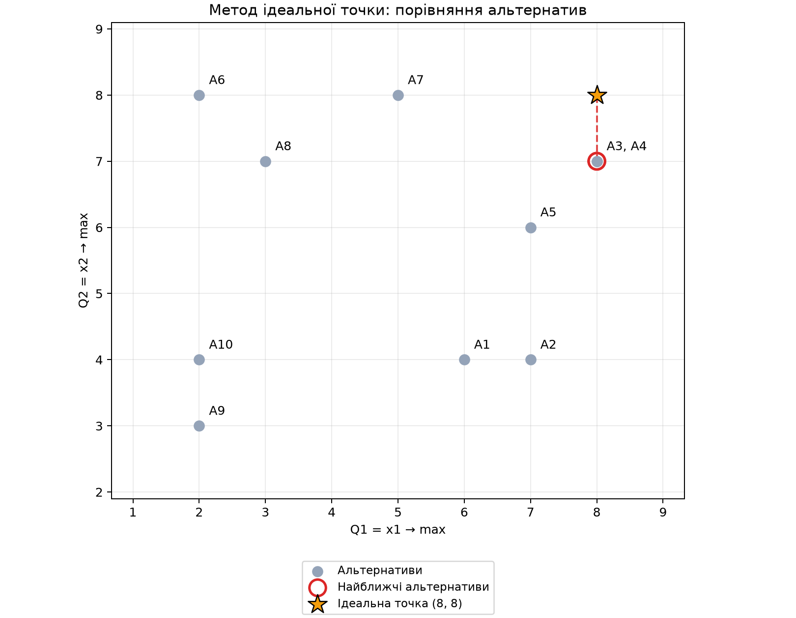

# Лабораторна робота №7

## Метод ідеальної точки

### Вхідні дані

Номер у журналі: **5**. Кількість альтернатив: **10**.
Координати належать [2; 8] включно.
Ваги лінійної згортки: **0,3 та 0,7**.
Ідеальна точка: **(8, 8)**.

### Таблиця результатів

| Альтернатива | x1 = Q1 | x2 = Q2 | Парето | Хто домінує | Sᵢ → max | dᵢ → min |
|:---:|---:|---:|:---:|---|---:|---:|
| A1 | 6 | 4 | Ні | A2, A3, A4, A5 | 4.6000 | 4.4721 |
| A2 | 7 | 4 | Ні | A3, A4, A5 | 4.9000 | 4.1231 |
| A3 | 8 | 7 | Так | — | 7.3000 | 1.0000 |
| A4 | 8 | 7 | Так | — | 7.3000 | 1.0000 |
| A5 | 7 | 6 | Ні | A3, A4 | 6.3000 | 2.2361 |
| A6 | 2 | 8 | Ні | A7 | 6.2000 | 6.0000 |
| A7 | 5 | 8 | Так | — | 7.1000 | 3.0000 |
| A8 | 3 | 7 | Ні | A3, A4, A7 | 5.8000 | 5.0990 |
| A9 | 2 | 3 | Ні | A1, A2, A3, A4, A5, A6, A7, A8, A10 | 2.7000 | 7.8102 |
| A10 | 2 | 4 | Ні | A1, A2, A3, A4, A5, A6, A7, A8 | 3.4000 | 7.2111 |

### Оптимальні альтернативи

| Метод | Результат |
|---|---|
| Множина Парето | **A3, A4, A7** |
| Лінійна згортка | **A3, A4**, S = 7.3000 |
| Метод ідеальної точки | **A3, A4**, d = 1.0000 |

### Графічне представлення

